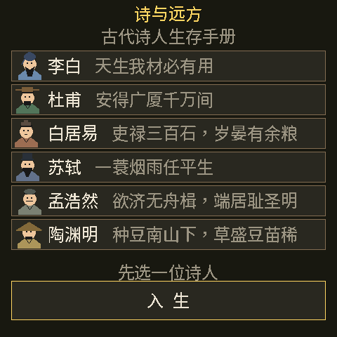
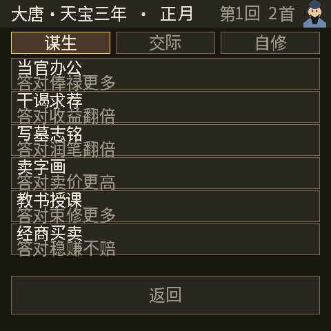

# poet_life《诗与远方》· 古代诗人生存手册（大白话版）

一句话：**选一位古代诗人，过十五个月（"回"）的日子**。每回挑一件事做（谋生/交际/自修），
做完结算这个月的得失，再抽一张事件卡做一次抉择。**六项数值里任何一项掉到 0，就按对应的死法
结束这一生**；活满十五回，就按最高的成就给你一个称号。

- 平台：ESP-Mosaico（esp32s31 + CO5300 480×480 正方形触摸屏），游戏引擎 Raylib Lite
- **纯离线**：诗人、事件、520 道题、中文点阵字模、头像全部编进固件，没有资源分区、不联网
- 玩法内核来自一个单文件浏览器游戏《古代诗人生存手册》，形式照搬同作者的 `tamaweb_pet`

| 选诗人 | 小传 + 初始六维 | 每月挑一件事 | 答题 | 事件抉择 | 结局 + 履历 |
|---|---|---|---|---|---|
|  |  |  |  |  |  |

---

## 1. 一分钟看懂怎么玩

1. 标题页点一位诗人的名字（头像会左右轻微摆动），再点 **开始**。
2. 小传页看完这位诗人的出身和初始六维，点 **进入这十五年**。
3. 之后每一回都是同一套动作：**挑一件事做 → 答一道题 → 看这个月结算 → 抽一张事件卡做抉择**。
4. 六维（银两/粮食/名声/体魄/诗兴/人脉）**任何一项到 0 就死**，死法各不相同，共 6 种。
5. 没死就一路走到第 15 回，结局页给你称号 + 得分 + 可以翻页的生涯履历。
6. 中途拔电/重启会**从本回合开头继续**（存档只存数字，不存履历文案）。

---

## 2. 六位诗人（开局差别就是难度差别）

| 诗人 | 朝代 / 官身 | 银 | 粮 | 名 | 体 | 兴 | 友 | 初始诗 | 专属技能（排在"自修"页签末尾） |
|---|---|---|---|---|---|---|---|---|---|
| 李白 | 唐 / 翰林供奉 | 80 | 40 | 80 | 70 | 90 | 40 | 2 | 醉酒诗百篇：喝酒十倍诗兴，但伤身体 |
| 杜甫 | 唐 / 左拾遗 | 20 | 15 | 70 | 40 | 80 | 35 | 3 | 忧国忧民：写诗抒怀，得名望但伤身 |
| 白居易 | 唐 / 江州司马 | 50 | 60 | 65 | 60 | 60 | 50 | 2 | 理财有道：经营产业，银两收益增加 |
| 苏轼 | 宋 / 黄州团练副使 | 40 | 40 | 75 | 65 | 85 | 70 | 3 | 研究美食：花小钱享受生活，身心俱佳 |
| 孟浩然 | 唐 / 布衣 | 60 | 70 | 50 | 55 | 50 | 30 | 2 | 田园隐逸：隐居消耗减半，诗兴自足 |
| 陶渊明 | 晋 / 前彭泽令 | 30 | 50 | 60 | 45 | 60 | 20 | 3 | 采菊东篱：采菊养性，精神大振但种地不行 |

杜甫是"地狱开局"：粮 15、体 40，每月还要消耗 10 粮，两三回不吃饭就饿死。
孟浩然钱粮最厚但诗兴只有 50，走"闭门作诗"（门槛诗兴 ≥15）容易越写越空。

---

## 3. 六维 = 六条命，一条见底一种死法

| 维度 | 上限 | 见底死法 | 常见掉法 | 常见补法 |
|---|---|---|---|---|
| 银两 | 无上限（最低 0） | **穷死**：连买砚台的钱都没有 | 宴饮 −20、诗会 −10、游历 −30、干谒/经商的开销 | 干谒、写墓志铭、卖字画、教书、当官办公、经商 |
| 粮食 | 无上限（最低 0） | **饿死**："幼子饥已卒" | **每回固定 −10**，游历再 −15 | 隐居务农（+35）、游历之外的囤粮、事件里买粮 |
| 名声 | 100 | **臭死**（社死）：诗被人拿去糊墙 | 隐居务农 −10、干谒失败 −10、时疫、邻里纠纷 | 参加诗会、闭门作诗、贵人赏识、皇帝寿辰 |
| 体魄 | 100 | **弱死**：病骨支离，药石无医 | 断粮惩罚（−10）、游历/宴饮/教书的损耗、饮酒 | 静养休息（+15）、隐居务农、研究美食、事件进补 |
| 诗兴 | 100 | **傻死**：文思枯竭，一个字写不出 | 几乎每个行动都扣（作诗 −18 起、答错更多） | 静养休息（+10）、灵感迸发事件、宴饮/诗会、李白的酒 |
| 人脉 | 100 | **闷死**：对着墙壁说了三天话 | 干谒欠人情（−10）、隐居务农（−10）、闭门不出 | 宴饮交友、旧友重逢、刺史设宴 |

补充两条硬规则：

- **名声/体魄/诗兴/人脉**四项夹在 0~100；**银两/粮食**只夹下限，可以攒很多（结局分数也看它们）。
- 死因判定就是"这六个数按顺序扫，谁先 ≤0 就是谁"，所以**一回里同时崩两项，只按排在前面的那个算**。

---

## 4. 一回合的完整流程（每回都是这七步）

1. **月度面板**（顶栏左边是年号+月份，右边"第 N 回 + 诗数"）→ 点 **本月行事**。
2. 进**行动页签**：三个页签 **谋生 / 交际 / 自修**，每页列出当前可选的事，灰的表示门槛不够。
3. 点一件事 → 进**答题页**（四选一，题目从这件事对应的题库随机抽）。
4. 选完答案 → 回月度面板看**结算文字**（"你的画作被识货之人高价买走！得 93 两"）。
5. 系统跑**月结**：有官职的 **+15 银两**；**粮食 −10**；粮食已经见底则再 **体魄 −10、粮食 +5**（忍饥挨饿）。
6. **抽事件卡**：25% 概率抽到你这位诗人的**专属事件**（李白"千金散尽"、杜甫"秋风所破"…），
   否则从 18 个通用事件里随机。事件给两个抉择，部分抉择还要再答一道题。
7. 点 **继续** → 推进到下一回（此时写一次 NVS 存档）。六维有见底 → 结局页；否则到第 15 回结束 → 结局页。

---

## 5. 12 个通用行动 + 1 个专属

| 页签 | 行动 | 门槛（不满足就点不动） | 答题题库 | 答对 | 答错 |
|---|---|---|---|---|---|
| 谋生 | 当官办公 | **必须有官职** | 官制文史 | 银+35 名+5 兴−3 | 银+20 名+2 兴−5 |
| 谋生 | 干谒求荐 | 名 ≥20 且 友 ≥10 | 干谒常识 | 银 +60~150（含名声/灵感加成）名+5 兴−5 **友−10** | 五五开：要么银 +40~100 名+2 兴−8 友−10，要么**名−10 兴−8 友−10**（颜面尽失） |
| 谋生 | 写墓志铭 | 名 ≥30 | 墓志铭 | 银 +70~130 名+5 兴−8 | 银 +30~70 **兴−14** |
| 谋生 | 卖字画 | 无 | 书画艺术 | 银 +30~80 名+3 兴−6 | 银 +15~50 兴−10 |
| 谋生 | 教书授课 | 无 | 经典典籍 | 银+25 名+5 兴−3 体−1 | 银+15 兴−5 体−2 |
| 谋生 | 经商买卖 | 银 ≥30 | 古代商业 | 投 ≤40 两，**赚 50%~129%** | 一半概率赚 30%~99%（投 ≤30），否则**亏 20%~59%** |
| 交际 | 宴饮交友 | 银 ≥20 | 宴饮文化 | 银−20，**人脉+15 兴+12**（×人脉加成） | 银−20，人脉+8 兴+8 体−3 |
| 交际 | 参加诗会 | 银 ≥10 | 诗词格律 | 银−10，**名 +15~25**、兴+10（×人脉加成） | 银−10，名 +5~15、兴+6 |
| 交际 | 游历天下 | 银 ≥30 且 粮 ≥15 | 地理名胜 | 银−30 粮−15，名 +18~28、兴+18 | 银−30 粮−15，名 +8~18、兴+12、**体−5** |
| 自修 | 闭门作诗 | 兴 ≥15 | 诗人作品（本人） | 名 +15~25（×灵感×同类）、兴−18、**诗 +1** | 名 +5~15、**兴−22**（这首诗不算数） |
| 自修 | 隐居务农 | 无 | 农事田园 | **粮+35**、名−10、体+6、兴−10、友−10 | 粮+18、其余同上（"草盛豆苗稀"） |
| 自修 | 静养休息 | 无 | **不答题** | 体+15 兴+10 | — |
| 自修 | 该诗人的专属 | 无 | 诗人作品（本人） | 李白 银−8 名+30 体−3 兴+30；杜甫 名+18 体−3 兴+20 **诗+1**；白居易 银+40；苏轼 银−8 体+18 兴+15；孟浩然 名+8 粮+8 兴+20；陶渊明 名+8 兴+22 **诗+1** | 各有一套打折值（见 `main/poets_game.c` 的 `bad_e`） |

三件事一眼看穿：**涨钱靠谋生，涨名声靠诗会/游历，涨人脉只能靠宴饮**；
**只有"闭门作诗"和两位诗人的专属技能出诗**，而诗数是称号的硬门槛。
13 件事一屏放不下，所以按"谋生/交际/自修"分三组，专属技能排在表尾归进"自修"。

---

## 6. 结算倍率：同样一件事，为什么有时赚得多

所有正向收益都要连乘下面几个千分比系数（沿用原作的整数除法，所以结果可复现）：

| 系数 | 公式 | 实际效果 |
|---|---|---|
| 名声加成 | `500 + 名声×10`（千分比） | 名声 0 只有**五成**，名声 50 是 1.0 倍，名声 100 是 1.5 倍 |
| 灵感枯竭 | 诗兴 < 20 时 ×0.5 | 快写不出诗时，干什么收益都腰斩 |
| 连做同类 | 与上一回同一大类时 ×0.85 | 别连着三个月都去卖字画 |
| 人脉加成 | 交际类且人脉 ≥40 时 ×1.3 | 朋友多了应酬才划算 |

---

## 7. 事件卡与题库（内容量都在这里）

- **24 张事件卡**：18 张通用（故人来访、灵感迸发、润笔订单、朝廷征召、粮价暴涨、诗会邀请、
  贵人赏识、时疫来袭、商人约稿、家书催银、天降大雨、偶遇少年、刺史设宴、书商来访、邻里纠纷、
  皇帝寿辰、画作被赏识、旧友重逢）+ **6 张专属**（千金散尽/秋风所破/江头送客/黄州猪肉/鹿门山雪/草盛豆苗稀）。
- 每张卡 2 个抉择，抉择可以挂 `quiz_category`：**先答题，再按答对/答错两套结果分别结算**，
  两套都各有一句正文。
- **16 类共 520 道题**，每题四选一，答完给一段**解释**（部分题还附一句**背诵**，比如
  "纨绔不饿死，儒冠多误身"）。题量：墓志铭 40、干谒 40、典籍 40、宴饮 40、格律 48、地理 40、
  农事 40、官制 40、书画 36、商业 36、六位诗人的"诗人作品"各 20。
- **兜底**：某个题库被抽空时直接按"答对"处理，绝不会卡在答题页出不去。

---

## 8. 结局：9 个称号按顺序判定，第一个满足的胜出

```
1 诗坛巨匠   名声 ≥85 且 诗 ≥3        6 丰衣足食   粮 ≥150
2 富贵达人   银 ≥250 且 粮 ≥150       7 安稳文人   名 ≥40 且 银 ≥100
3 人脉广布   人脉 ≥70                 8 寒酸书生   银 <30 且 名 <30
4 悲剧诗人   体魄 ≤20                 9 平凡一生   以上都不满足
5 诗兴盎然   诗兴 ≥70 且 诗 ≥3
```

得分（结局页右上角那个数）：

```
分数 = ( min(银,200)×5 + min(粮,150)×3 + 名×15 + 诗×200 + min(友,50)×5 + (有官职 ? 300 : 0) + 5 ) / 10
```

**诗数是权重最高的一项（×200）**，所以想拿高分必须挤出回合"闭门作诗"。
死掉的结局没有称号，只有对应死法那一段话（六段文案各 2 句，见 `main/poets_game.c` 的 `s_death_texts`）。

---

## 9. 页面与触摸区（480×480，方便真机验证）

七个页：`TITLE 选诗人 → BIO 小传 → HOME 月度面板 → ACTION 行动 → QUIZ 答题 → EVENT 事件 → ENDING 结局`。
统一边距 `PAD=16`，正文宽 448（正好 18 个整宽汉字），主按钮固定在 `y=400`、高 56。

| 页 | 可点区域 |
|---|---|
| 标题页 | 6 行诗人，`y = 72 + 48i`，高 44（每行左侧一张 40×40 头像）；开始按钮 `y=400` |
| 小传页 | 底部左右两个半宽按钮（`y=400`） |
| 月度面板 | 主按钮"本月行事" `x=16 w=340`；右侧"结束生涯" `x=364 w=100` |
| 行动页 | 三个页签 `y=46` 高 32；行动行 `y = 84 + 48r`；返回 `y=400` |
| 答题页 | 四个选项 `y = 108 + 52i`，高 48；答完才出现"继续" `y=400` |
| 事件页 | 两个抉择 `y=288` / `y=340`，高 44；"继续" `y=400` |
| 结局页 | 履历翻页 `上页 (16,368,88×26)`、`下页 (376,368,88×26)`（每页 2 条）；"再来一局" `y=400` |

页眉右侧从"进入这十五年"之后一直挂着**当前诗人那张脸**（选诗人页 6 行、其余页右上角 1 张）。

---

## 10. 头像和中文是怎么来的（不占资源分区）


- **头像**：`tools/gen_poet_avatars.py` 用 PIL 画 6 张 40×40 肖像（每人一套 5 色调色板：
  透明/墨/肤/袍/巾），烘成**水平游程 span**（`(x, y, 宽, 色号)`，一行一色一次 `DrawRectangle`），
  共 **465 个游程 / 11 KB** 源码，生成 `main/generated/pl_avatar_data.{c,h}`。
  摆动偏移 ±3px、0.8 秒一个来回、六位错相位，**在 `prepare()` 里按 `state.tick` 算好，render 只读**。
- **中文**：`tools/gen_cjk_font.py` 扫描 `main/` 里所有中文字面量，从
  **Noto Sans CJK SC Regular（SIL OFL 1.1）** 母字体光栅化出 **2288 个 24×24 单色字模**，
  写进 `main/pl_cjk_glyph_data.c`；`main/pl_text.c` 负责中英混排断行（只画放得下的整字，宁可少一个字也不切笔画）。
- **改文案必须走这四步**（少一步就会在设备上"字凭空消失"）：
  1. 编辑 `data/*.json`（诗人/事件/题库）→ `python tools/poets_gen.py` 重生成 `main/generated/poets_data.*`
  2. `python tools/gen_cjk_font.py` 重烘字模
  3. `python tools/text_metrics.py` —— 必须打印"字面量全部命中"，并看各字段最长像素宽
  4. 跑第 13 节的单测与回放

---

## 11. 存档与音效

- **存档**：NVS，namespace `poet_life`，key `run`，固定 **40 字节**小端 blob
  （magic + version + 诗人下标 + 页 + 回合 + 六维 + 诗数 + RNG + 校验和）。
  **每回开始时写一次**；进结局页立刻抹档（一生已定，重启就该回到选诗人）；
  解码后发现是死者档或回合数越界，也立刻抹掉。
  **履历和文案不入库**——换来少 3 KB 的写放大，也省掉一套版本兼容；代价是续档只报数字。
- **音效**：RTTTL 表驱动合成（BSP 的 ES8311），8 种语义音：
  点击/翻页、行动结算、点不动（未解锁）、答对、答错、事件卡、死亡、十五年修满。
  宿主仿真里是同名空实现，所以两侧游戏代码完全一致。

---

## 12. 代码结构：谁负责什么

| 文件 | 职责 | 依赖 |
|---|---|---|
| `main/poets_game.c/.h` | **规则内核**：行动结算、倍率、月结、事件抽取、死因、称号与得分、存档编解码数据结构 | **零依赖纯 C**，电脑上直接跑测试 |
| `main/generated/poets_data.{c,h}` | 内容表（6 诗人 / 24 事件 / 12 行动 / 16 题库 520 题 / 年号月份） | 生成物，勿手改 |
| `main/generated/pl_avatar_data.{c,h}` | 头像游程与调色板 | 生成物，勿手改 |
| `main/game.c` | 七页 UI：布局、点击区、排版、流程 | 引擎头 |
| `main/game_module.c` | 引擎生命周期适配 + `state_json`（回放脚本读它） | Raylib Lite |
| `main/pl_font.c`、`pl_text.c`、`pl_cjk_glyph_data.c` | 24×24 字模与中英混排断行 | — |
| `main/pl_avatar.c` | 头像绘制（游程 → `DrawRectangle`） | 引擎 |
| `main/pl_save.c` | 存档**纯编解码**（设备与宿主共用同一条字节路径） | 纯 C |
| `main/pl_store.c` / `pl_store_host.c` | NVS 后端 / 宿主桩 | ESP-IDF |
| `main/pl_sfx.c`、`rtttl_player.c` / `pl_sfx_host.c` | RTTTL 表 + 设备播放器 / 宿主空实现 | ESP-IDF/BSP |
| `data/*.json` | 内容源（唯一该改的地方） | — |
| `tools/` | 抽取器、生成器、字模、文案度量 | node + Python + PIL |
| `tests/` | 宿主单元测试（gcc）+ 6 条回放脚本 | MinGW gcc |

**三条铁律（改代码前先看）**：

1. **输入相关的几何只在 update 路径算**。`prepare()` 每帧重建点击区和排版，`game_render()` 只读——
   无头回放只渲染最后一帧，任何在 render 里算出来的输入相关状态都是 bug。
2. **开局种子由所选诗人推出**，同一位诗人每次走同一条随机流，回放才能断言具体数值。
3. **选项文案字段可能缺字段**，所有 `%s` 前先退化成空串，绝不让 `NULL` 进 `snprintf`
   （Windows CRT 打 `(null)`，设备上直接凭空消失）。

---

## 13. 你自己怎么跑

前置（本工程是 ESP-Mosaico 工作区里的一个应用目录，构建/装机要用工作区工具链）：

> **单独 clone 本仓库不能构建**：`CMakeLists.txt` 与 `main/idf_component.yml` 用
> `../../submodule/...` 相对路径找 utils / BSP / Raylib Lite 引擎，所以必须把本仓库放到
> 工作区的 `projects/poet_life` 目录下。纯逻辑部分不受此限制——`tests/build_tests.ps1`
> 只依赖 gcc 与 `main/` 里的纯 C 内核。

- 工作区：`esp-mosaico-vibe`（含 `mosaico.py`、`submodule/raylib-lite-engine`、GSP 1.5.1 本地 override）
- ESP-IDF 固定在 commit `7b9cc1ac79f865983f59bb8ff3ff43eb74ff1dbe`，target `esp32s31`
- 宿主测试要一个 C 编译器（本机用 `D:\esp-mo\mingw\w64devkit\bin\gcc.exe`）
- 字模重烘需要母字体 `NotoSansCJKsc-Regular.otf`（脚本里的路径 `D:/esp/fontsrc/` 按你机器改）

```sh
# 1) 纯逻辑 + 排版单元测试（电脑 gcc）：5581 + 4623 条断言
powershell -ExecutionPolicy Bypass -File projects/poet_life/tests/build_tests.ps1

# 2) 交互式仿真（电脑窗口，鼠标当手指）
python mosaico.py game sim --project projects/poet_life

# 3) 无头回放取证：录制的点击驱动页面流程，导出状态 JSON
python mosaico.py game sim --project projects/poet_life --headless \
    --frames 39 --scenario projects/poet_life/tests/replay/p6_full.json \
    --state-output projects/poet_life/build-host/st_p6.json

# 4) 文案度量与字模覆盖（必须报"字面量全部命中"）
python projects/poet_life/tools/text_metrics.py

# 5) 构建固件（约 6 分钟；脚本已清 MSYS 泄漏、已删 .ninja_deps）
powershell -ExecutionPolicy Bypass -File projects/poet_life/build_poet_life.ps1

# 6) 装机（走 mosaico.py 的 system-update，含 Recovery 切换与兼容性检查）
powershell -ExecutionPolicy Bypass -File projects/poet_life/flash_poet_life.ps1
#    已经构建过、只想复用 bundle：加 -SkipBuild（省掉整轮重编）
```

六条回放（`tests/replay/`）：`p1_bio` 小传、`p2_action` 行动页签、`p3_quiz` 答题、
`p4_event` 事件抉择、`p5_ending` 空履历结局、`p6_full` 完整 27 击走到"饿死"结局并翻完履历。
宿主状态暴露 `page`、`tab`、`turn`、六维、`poems`、`dead`、`event_pending`、`state_hash`，
回放脚本靠这些数字断言"点中了哪一格"。

**构建环境的三个坑（都已固化进脚本，别在命令行里裸跑）**：

1. Git Bash 会把 `MSYSTEM` 等变量漏给子进程，ESP-IDF 的 export 直接以
   "MSys/Mingw is not supported" 中止 → 脚本先清这些变量。
2. ninja 的 `.ninja_deps` 会把 GSP 生成文件记成 `/D:/` 样式路径，增量构建死在
   `FindFirstFileExA(/D:/…)` → 构建前删掉它（`flash_poet_life.ps1 -MoveDepsAside` 只做"挪开"）。
3. `idf_tools.py export` 只在 `~/.espressif/python_env/idf6.2_py<小版本>_env` 的基座解释器还在时
   才报告 `IDF_PYTHON_ENV_PATH`；基座被清理软件删掉时它会**静默不报这一行**。
   修法：`python D:\esp-mo\esp-idf\tools\idf_tools.py --non-interactive install-python-env`。

---

## 14. 真机状态：已装上并稳定 30 FPS，还差你亲手确认三件事

装机证据（`python mosaico.py iris device-status --project projects/poet_life --json`）：
Device ID `4553502d4952495301001c2904d08602` 全程未变，`firmware_mode=normal`，
`project_name=poet_life`，新 Boot ID `10842006608058726246`，**`crash_count=0`**。

日志证据（`iris logs --snapshot`）：`co5300_spi LCD panel create success` →
`CO5300 initialized: 480x480` → `esp_gsp_esp_lcd: UI live: 1 scene(s), 480x480` →
`poet_life: first frame presented; OTA image accepted`（2993 ms）。此后满帧跑：
`logic=29.7~30.2 display=29.7~30.2 dropped=0 busy=0 errors=0 overflow=0`，
`render=8.3~13.5 ms`、`update=96~109 µs`、堆空闲 230 KB、PSRAM 空闲 13.2 MB——
**2288 字模 + 头像在设备上跑得满 30 fps**。

分区余量要留意：`poet_life.bin` = 0x1b2500，app 分区 0x1c0000，**只剩 56 KB（3%）**，
再加素材前先看这一行。

**触摸重复触发已修**（真机首测报"一次触碰变成连续几次、界面乱跳"）。根因不在本工程的
`game_set_pointer`（它已经只在上升沿出一次 tap），而在引擎
`submodule/raylib-lite-engine/components/mosaico_game_app/mosaico_game_app.c` 的 `touch_task`：
单点路径每 12 ms 轮询一次、`pressed = count > 0`，手指还按住时偶发的一轮空报就被转成一次松手，
下一轮又变按下，一次按压被拆成多个上升沿。现在改成**连续 3 轮空报（约 36 ms）才承认松手**，
按住期间每轮重发按下。宿主回放走 `MosaicoFastInjectPointer`、不经过 `touch_task`，
所以六条回放的取证一字未变。

raylib-lite 引擎**不提供屏幕镜像帧源**，`iris screenshot` 必然失败，所以以下三点只能靠眼耳手：

1. **触摸手感**：一次点击是否只推进一页（标题→小传→月度面板）。
2. **头像**：6 张脸是否左右小幅摆动、页眉那张脸是否和文字挤位。
3. **声音与续档**：8 种音效是否响、拔电重插是否回到本回合开头。

（`cst9220: Malformed report header` 刷屏是触摸驱动自写 `0xAB` 回读，不能据此判触摸坏。）

---

## 15. 已知取舍（这些不是 bug）

- **不联网**：原作的分享、云存档一概不做，纯离线单机。
- **一"回"就是一屏**：没有地图、没有角色走动，全部信息用文字面板表达（这是"生存手册"的体裁）。
- **素材从简**：头像是程序画的 40×40 色块肖像，不是美术稿；只保证"看得出是谁、在动"。
- **十五回定长**：中途不能存档点回跳，结局即抹档，重开只能从头选诗人。
- **履历不入库**：续档只报数字（第 11 节）。
- **无屏幕镜像**：引擎限制，验收靠日志 + 人眼。

---

## 16. 内容与许可

- 玩法与文案源自单文件浏览器游戏《古代诗人生存手册》
  （本地副本 `D:\novel-to-game-main\game-adaptations\ancient-poets`），
  由 `tools/extract_data.js <原 html> data/` 一次性抽成 `data/*.json` 后再进固件；
  `data/*.json` 是本仓库的内容真相，原始 html 不入库。
- 中文点阵来自 **Noto Sans CJK SC Regular**，许可 **SIL OFL 1.1**（只分发派生的位图字模表）。
- 本工程源码沿用工作区的 `Apache-2.0` 头（各文件首行 `SPDX-License-Identifier`）。
- 形式参考同工作区的 `projects/tamaweb_pet`（Raylib Lite 游戏 + 纯 C 内核 + 宿主仿真回放取证）。
